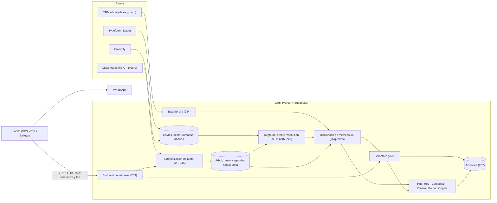
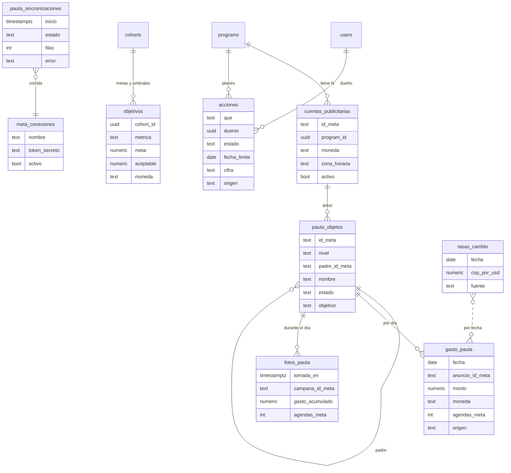
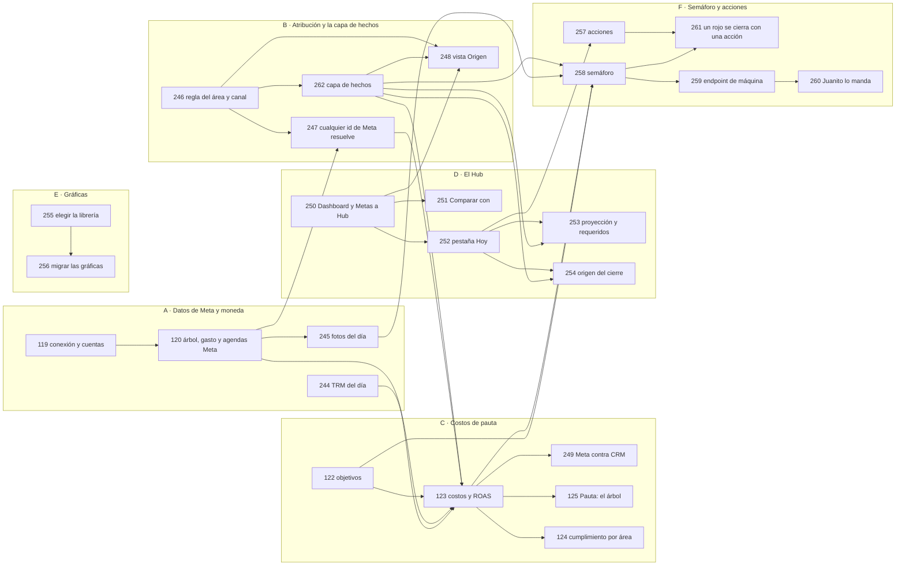

# El Hub: el plan de las métricas del CRM

> **Complemento de [`plan.md`](./plan.md) para los componentes 8 (Pauta) y 9 (Métricas), no reemplazo.** Nace
> del audit del **14-oct-2026** (Mani y la sesión principal): las cinco versiones del reporte diario de
> septiembre, el handoff de Meta del 13-oct, las notas de Mani sobre ROAS, CPI, CAC y el semáforo de 30X, el
> dashboard que hay hoy en el código y lo **medido** esa noche en producción, en Meta y en Typeform (solo
> lecturas). Mandan sobre él los ADR **0086 a 0090** (nacen de esta sesión) y los tickets; el estado de cada
> ticket vive solo en [`tasks/README.md`](./tasks/README.md) y las decisiones abiertas en `plan.md` §7 (lista
> única, letra E). Si algo aquí contradice un ADR o un ticket, gana el ADR o el ticket y este documento se
> corrige.
>
> **Desde el 14-oct, §5 es el diccionario de métricas: la única tabla de definiciones.** Reemplaza a
> `analytics.md` §6, que queda como historia de la reunión con Pauta.

Leyenda: ✅ existe o decidido · 🟡 propuesta, falta el ok de alguien · 🔴 falta decidir · ❌ no existe · 🩸 dato
medido que cambia el plan.

---

## 1. El norte

**El Hub contesta cada día, por programa y sin armar nada a mano: ¿vamos a llegar a la meta, dónde se traba la
operación y qué hacemos hoy para llegar?**

Es *action-driven*: una cifra entra a la primera pantalla solo si tiene una meta, un umbral o un dueño que
actúe sobre ella. Lo demás vive debajo o en la lista que la cifra abre. La lección viene medida de 30X
(`semaforo-30x-analisis` en el vault): su semáforo detecta perfecto y nadie atiende los rojos, hasta diez días
seguidos. **Detectar no es actuar**, así que el Hub cierra el ciclo con las acciones (H-7).

**El foco de esta versión** (Mani, 14-oct): la operación comercial y el gasto de pauta, o sea todo lo que es
entrada y proceso del lead. Los masivos de Kapso y la cola de descartados van después (H-9).

### Los objetivos, cada uno verificable

| # | Objetivo | Se verifica cuando |
|---|---|---|
| O1 | El reporte diario se lee en el Hub, sin armar nada a mano | la estructura del reporte del 15-sep (día, semana, cohorte, mes, acciones) sale entera de la pestaña Hoy con datos del CRM |
| O2 | El gasto de Meta entra solo, por anuncio y por día | el gasto de un día elegido a mano cuadra con el Administrador de anuncios en cada cuenta |
| O3 | CPL, costo por agenda, costo por venta y ROAS con una sola definición | cada cifra sale de un módulo (§5), con la TRM usada a la vista |
| O4 | El semáforo llega por WhatsApp y cada rojo termina en una acción | un rojo armado a mano llega por Juanito y no se cierra sin una acción registrada |
| O5 | Las gráficas se leen sin explicación | una librería, ejes lineales, número y % en cada punto, clic que abre la lista |

### Quién lo lee

| Actor | Qué hace en el Hub |
|---|---|
| Gerencia (Dani, Alejo) | abre **Hoy** en el daily comercial: ¿vamos bien?, ¿qué se decidió? |
| Ops (Mani) | todo, más la vista de Origen para auditar la atribución y la pauta |
| Paid trafficker (Ander y su equipo) | Pauta y Origen de sus programas; recibe el semáforo; sin comparativo entre closers ni comisión (ADR 0052) |
| Closer | **no entra** (ADR 0082): sus cifras viven en Mi espacio |

---

## 2. El audit (14-oct, medido)

### 2.1 Las fuentes revisadas

| Fuente | Qué aportó |
|---|---|
| `reportes diarios/` (1, 3, 9, 14 y 15 de septiembre, versiones 3 a 7) | la estructura que el Hub tiene que reemplazar (§2.3) |
| Handoff de Meta del 13-oct y el plan `plan-meta-centralizado` del vault | el portafolio, el token y las 7 cuentas (§2.4) |
| `semaforo-30x-analisis`, `glosario-metricas`, `runbook-meta-vs-forms` (vault) | la anatomía del semáforo y el control Meta contra formularios |
| Notas de Mani (14-oct) | ROAS, CPI, CAC, la duda de los canales, el semáforo por WhatsApp |
| `analytics.md`, `comercial.md`, ADR 0062, 0063, 0067, 0079, tickets 119 a 125, 067, 090 y 021 | lo decidido antes y lo que quedó sin construir |
| El código del dashboard (`app/(app)/p/[programa]/dashboard`, `components/dashboard/`, `lib/queries/`) | lo que existe hoy (§2.2) |
| Producción, la API de Meta (v26.0, token de solo lectura) y la de Typeform | los hechos de §2.4 a §2.6 |
| El repo de Juanito (`30X/repos/Juanito`) | dónde vive el envío del semáforo (H-6) |

### 2.2 Lo que hay hoy

El Dashboard del programa tiene cuatro pestañas (148, 197) y la página Metas va aparte (146):

| Pestaña | Qué muestra |
|---|---|
| Pulso | meta del mes (vendidos, avance, deuda), contratado, banderas rojas (shows sin Grain, llamadas pasadas sin resultado, atendidos sin valor o sin Grain), alertas por persistencia |
| Operación | embudo comercial (agendas, shows, cierres sobre el mismo grupo, ADR 0079), closers, agendas por semana y próximas, conversión y tiempo por etapa, abiertos por owner, sin dueño, motivos de pérdida, deals contra agendas |
| Dinero | contratado, comisión, descuento promedio, ventas por cohorte, cartera, series por mes |
| Pauta (interina) | registros, sin UTM y macros por canal y campaña, origen del lead, registros contra agendas por canal, embudo del formulario y por pregunta |
| Metas (página) | meta del mes, compensación de la semana y de la cohorte |

Toda cifra abre su lista (ADR 0067). Las gráficas están hechas a mano en SVG (`components/series-lineales.tsx`),
sin librería. El selector de periodo pone "A" y "B" en pantalla, y Mani lo encuentra difícil de entender.

**Producción desde el reinicio del 7-oct** (TI y CA): 498 envíos, 361 llamadas y 30 abonos. La operación ya vive
en el CRM, así que el reporte diario ya puede salir de aquí.

### 2.3 El reporte diario contra el CRM

| Del reporte diario | En el CRM | Dónde | Queda en |
|---|---|---|---|
| Contexto: "semana día 2 de 5, mes día 11 de 22, cohorte día 20 de 30" | 🟡 se calcula en Metas, sin una línea que lo diga | Metas | 252 |
| Cupos del día contra la meta dinámica (faltan ÷ hábiles que quedan) | ✅ meta dinámica (020) | Pulso, Metas | 252 |
| Leads del día contra su meta | ❌ `cohorts.meta_leads_dia` está vacía en las 8 cohortes y no se deriva | · | 253 |
| Leads de pauta del día | ✅ por área | Pauta | 248, 252 |
| Caja del día | ✅ recaudo por fecha del abono | Dinero | 252 |
| Agendas, realizadas, show, ventas y % de cierre, por programa y por closer | ✅ (ADR 0079) | Operación | 252 |
| El resultado de cada agenda (no-show, reprogramada, motivo) | ✅ en la lista de cada cifra | Operación | · |
| Cómo nació cada cierre: agenda del día, follow-up o cola | ❌ | · | 254 |
| Autoagendamiento por el formulario | ✅ embudo del formulario | Pauta | · |
| Objeciones | ✅ motivos de pérdida | Operación | · |
| Semana: meta, meta a la fecha, real, cumplimiento | ✅ compensación semanal (146) | Metas | 252 |
| "Para llegar a 50 desde mañana": meta diaria y por semana que queda | 🟡 la meta diaria sí; el reparto por semana no | Metas | 253 |
| Leads por día hábil que hacen falta | ❌ | · | 253 |
| Cohorte: meta, vendidos, faltan, cumplimiento contra la meta lineal | ✅ | Metas | 252 |
| "A este ritmo cierra en 27" (proyección) | ❌ | · | 253 |
| Agendas diarias que hacen falta, con la tasa agenda → venta | ❌ | · | 253 |
| Mes: leads, cupos, cumplimiento contra la meta lineal | ✅ (146) | Metas | 252 |
| Planes de acción con estado y evidencia | ❌ | · | 257 |
| Masivos (Kapso) y cola de descartados | ❌ | · | fuera por ahora (H-9) |

### 2.4 Meta 🩸

**Una conexión, siete cuentas.** El portafolio **Agencia Retia Growth** (`1671066217989493`) tiene un usuario
del sistema (`retia-insights`, solo `ads_read`) que lee todas las cuentas. Los tickets 119 y 120 se escribieron
con otro supuesto (un portafolio por programa, una cuenta por programa, todo en COP; respuesta de Mani del
29-sep), y ese supuesto ya no se cumple:

| Programa | Cuenta | Moneda | Gasto 9 a 13-oct | Agendas según Meta |
|---|---|---|---|---|
| Tactical Investor | Tactical Assets SAS (`act_1342952299803987`) | COP | 4.235.327 | 47 |
| ComunicArte | Rosario Gomez ADS (`act_1645568323515892`) + Cuenta Publicitaria Milena Morales (`act_38820768`) | COP | 4.372.647 (las cuatro de CA) | 51 |
| ComunicArte | Milena \| Retia (`act_3197270037149688`) · Rosario \| Retia (`act_28282666154677312`) | USD | 0 en la ventana | · |
| ComunicArte (fuera de la alarma) | [CP] Milena Nas & Be (`act_873594601508669`) | USD | 0 | · |
| Comunícate con Confianza (Power Talk) | `act_567726836094755` | COP | 510.266 | 5 |

Las cuatro cuentas COP están en `America/Bogota`. Una cuenta USD de ComunicArte gastó USD 75 en los 30 días
anteriores, así que **un programa puede sumar gasto en dos monedas** (H-5).

**🩸 El id del anuncio no llega al CRM.** Medido anuncio por anuncio con sus `url_tags`:

| Cuenta | Anuncios creados desde el 29-sep | Plantilla |
|---|---|---|
| Tactical | 7 | 6 la vieja (`facebook / cpc`, conjunto en content, anuncio en term, `ad_id={{ad.id}}` aparte), 1 la de Pauta (inactivo) |
| Rosario (CA) | 12 | los 12 la vieja |
| Milena (CA) | 8 | la vieja o sin `url_tags` |
| Power Talk | 36 | los 36 la de Pauta (`paid_social`, `utm_id={{ad.id}}`) |

- La plantilla del 29-sep (DP-2, ADR 0062) **no se aplicó** en TI ni en CA.
- La vieja sí manda el id del anuncio, pero en `ad_id`, y los tres Typeform solo declaran `utm_*` como campos
  ocultos: **el `ad_id` se pierde al llegar**.
- En CA llega un `utm_id` en 113 envíos, y **es el id de la campaña**, no del anuncio (`52532647547375` es "AS |
  ABO | Metodo Comunicarte | Direct TypeForm | Sept 2026 | Rosario", verificado contra la API). Ningún anuncio
  declara ese `utm_id`; de dónde sale no se sabe.
- En TI no llega ningún id. En Power Talk llega el del anuncio en 2 de 11 envíos de pauta.
- Hoy la atribución llega a **campaña** (por el nombre exacto en `utm_campaign`), no a anuncio.
- ✅ **Arreglado en la fuente el mismo 14-oct** (ok de Mani): los tres Typeform declaran ahora `ad_id`, `adset_id` y
  `campaign_id` como campos ocultos (por API, con respaldo; el resto del form y los webhooks quedaron idénticos). Desde
  ahí los anuncios de TI y CA traen su id sin pedirle nada a Pauta. Las hojas de TI y CA ya no se usan (Mani), así que
  las columnas que se corran allí no importan (`operations.md` §2.1 e incidentes).

**Agendas: Meta contra el CRM (preliminar, lo hace bien el 249).** Del 9 al 13-oct (el 8 se excluye: el
reinicio cargó de una vez las citas que ya existían):

| Programa | Según Meta | Según el CRM (citas creadas de deals con origen paid) | Costo por agenda con Meta | Con el CRM |
|---|---|---|---|---|
| TI | 47 | 46 | ~COP 90.100 | ~COP 92.100 |
| CA | 51 | 35 | ~COP 85.700 | ~COP 124.900 |

En TI cuadran. En CA el CRM cuenta un tercio menos, y la diferencia cambia el veredicto sobre la pauta. Puede
ser atribución (el deal nació de un envío orgánico), llamadas sueltas o eventos duplicados del pixel: es
justo lo que el control de H-4 tiene que explicar.

### 2.5 La atribución

El área de un envío sale del catálogo `canales` (par `utm_source` / `utm_medium`, ADR 0051). Tiene **26 filas, y
22 son combinaciones de orgánico** (`instagram rosario` con `dm`, `linktree`, `manychat`, `stories`,
`storiesfijadas`...). Cada creadora nueva suma unas cinco filas: `instagram francisco` ya llega **sin
clasificar** desde que arrancó Comunícate con Confianza. La sospecha de Mani es correcta: no se sostiene.

Pares que llegaron desde el 7-oct (completos): CA `facebook/cpc` 204, `direct/organic` 40, `instagram rosario` y
`instagram milena` con cinco medios; TI `facebook/cpc` 164, **sin UTM 27 (12%)**, `instagram` con tres medios,
`tiktok` y `youtube`; Confianza `ig/paid_social` 11 y `instagram francisco` 6.

### 2.6 Lo que no cuadra entre documentos

| Dónde | Dice | Lo cierto |
|---|---|---|
| Handoff del 13-oct, paso 4 | el semáforo corre en "Vercel y Neon" | la base es Supabase (ADR 0047); Vercel está en Hobby: un cron al día |
| Handoff, paso 5, y el plan del vault (Fase 6) | "CRM (Dapta)" | el CRM es este repo; Dapta es un proveedor de formularios (130) |
| Handoff, paso 4 | "hay dos copias, confirmar cuál" | la viva es `retia-metrics-mani` (`Retia-Agencia/retia-metrics`); `retia-metrics` es del 6-sep, en el GitHub de Michael |
| Plan del vault | "la agenda no es el mismo evento en todos los programas" | el 13-oct se encontró que sí: `conversions` → `offsite_conversion.fb_pixel_custom.invitee_meeting_scheduled` en todos |
| Tickets 119 y 120, respuesta del 29-sep | una cuenta por programa, en COP | §2.4 |
| ADR 0062 punto 2 | la llave es `utm_id` = id del anuncio | en CA llega el de la campaña y en TI no llega (§2.4); lo corrige el ADR 0087 |
| `analytics.md` PT-20, ticket 123 | la burbuja "sin UTM · según el comercial" | el origen declarado se retiró (ADR 0081) |
| Glosario del vault | estándar CPI USD 20 / 75 / 100 | lo que dijo Pauta el 29-sep: meta COP 60.000, aceptable 80.000; los umbrales se vuelven filas (122) |

---

## 3. Las decisiones del 14-oct

Mani, en la sesión del audit. Cada una baja a su ADR; aquí va el resumen para leer el resto.

| # | Decisión | ADR |
|---|---|---|
| H-1 | **El Hub reemplaza al Dashboard y a Metas.** La tab se llama Hub y su primera pestaña, **Hoy**, es el reporte diario | 0086 |
| H-2 | **Periodo + "Comparar con", sin A ni B en pantalla.** "Comparar con": mismo punto del periodo anterior (por defecto), cohorte anterior al mismo día hábil, un rango que elijo, o no comparar. La regla del mismo día hábil del ADR 0067 no cambia | 0086 |
| H-3 | **El área sale de una regla y el detalle de pauta del árbol de Meta; los canales se definen solos.** Sin catálogo que mantener, con una vista que muestra cada UTM y cómo cuenta. Se captura el `ad_id` que ya mandan los anuncios | 0087 |
| H-4 | **Las agendas del CRM mandan el costo por agenda.** Las de Meta van al lado ("según Meta") y la diferencia es un control | 0088 |
| H-5 | **La TRM oficial de cada día del gasto, guardada, y la tasa usada siempre a la vista.** Cierra A12 | 0088 |
| H-6 | **El CRM calcula el semáforo y Juanito lo manda.** Juanito además es el reloj de la sincronización durante el día (Vercel Hobby solo deja un cron diario). Un endpoint de máquina, con secreto y sin datos personales | 0089 |
| H-7 | **Los planes de acción viven en el CRM.** Objeto Acción; un rojo del semáforo no se cierra sin una | 0090 |
| H-8 | **Las gráficas se hacen con una librería dentro del CRM.** La elige un ticket de exploración con criterios escritos; Claude Dashboards (8-oct) queda solo como referencia, porque vive fuera del CRM y se salta sus permisos. **Elegida el 14-oct: ECharts, siempre por una pieza propia** | 0091 |
| H-9 | **Foco: operación comercial y gasto de pauta.** Kapso (masivos y cola) después | · |
| H-10 | **Del reporte entran:** proyección y requeridos, origen del cierre y planes de acción | · |
| H-11 | **Una conexión de Meta (el portafolio de Retia) y N cuentas por programa, cada una con su moneda.** Enmienda la respuesta del 29-sep en el 119 | 0087 |
| H-12 | **El nombre "Hub"** se escribe así en la interfaz y entra al vocabulario (`overview.md` §11) | 0086 |
| H-13 | **No hay plantilla de UTM por programa.** Cada envío dice cómo leerse por su `utm_medium` (`cpc`: content = conjunto, term = anuncio; `paid_social`: content = anuncio, term = placement). En una misma cuenta conviven plantillas (Tactical tiene anuncios con cuatro), así que una plantilla declarada por programa mentiría. Lo que sí se ve es qué plantilla usa cada anuncio activo, leída de Meta (248) | 0087 |
| H-14 | **Los campos ocultos de Meta van en todo formulario** (`ad_id`, `adset_id`, `campaign_id` además de las seis UTM), desde el primer día en un programa nuevo; hecho el 14-oct en los tres Typeform | 0087 · `operations.md` §2.1 |
| H-15 | **La plantilla de Pauta deja de ser un bloqueo y pasa a ser orden.** A Pauta se le pregunta si la adopta en las campañas **nuevas** (HQ-8); lo viejo no se reescribe (ADR 0004) y queda en nivel campaña | 0087 |
| H-16 | **Dos reglas para todo el Hub** (Mani): nada escrito para el estado de hoy, y las métricas son consultas bien construidas y reutilizables. Contratos C-1 y C-2 (§8) | §8 · 262 |

---

## 4. Cómo funciona

### 4.1 El flujo

Un cron diario de Vercel cierra el día (re-lee los últimos 7 días, porque Meta ajusta hacia atrás). Durante el
día, el reloj es Juanito: llama al endpoint, que sincroniza el día en curso, guarda una foto del gasto y
devuelve el semáforo ya calculado. **Nadie más le pregunta a Meta**: una sola tubería y muchos consumidores.

### 4.2 Lo que se agrega a la base

`meta_conexiones` guarda **un solo** token activo (índice único parcial): el usuario del sistema de Retia es socio
de los portafolios de los clientes y lee todas sus cuentas, así que una cuenta no apunta a ninguna conexión (119,
enmienda del 14-oct).

Lo que **no** se guarda: el área de un envío, el canal, los costos, el ROAS, el semáforo, la proyección y los
requeridos. Todo eso se calcula al leer (ADR 0024). `canales` deja de leerse (H-3) y se retira cuando su
migración lo permita; `ad_spend` (vacía) la reemplaza `gasto_pauta` (120).

---

## 5. El diccionario de métricas

**La única tabla de definiciones del CRM.** Todas por programa (el programa es frontera, ADR 0043); en "todos
los programas" solo lo que se suma (ADR 0048). Fechas de Bogotá. Cada fórmula vive en **un** módulo de
`lib/queries/` y la importan el Hub, el semáforo y cualquier otra consulta (ADR 0024). Lo de §5.1 ya existe; lo
de §5.2 es nuevo.

### 5.1 Lo que ya existe (sin cambios)

| Métrica | Definición | ¿Se suma? |
|---|---|---|
| Registro | token con envío completo, por su fecha; parcial y completa cuentan una vez (ADR 0063) | sí |
| Dejó datos · Llegó al Calendly | como en el 126 (ADR 0069) | sí |
| Agenda | llamada vigente creada en el rango (`calls.created_at`) | sí |
| Llamada · Show | cita en el rango · llamada que ocurrió (`llamadaOcurrio`) | sí |
| Grupo de citas, % de show, % de cierre, agenda → venta | ADR 0079 (`tasas-del-grupo.ts`) | no |
| Venta | deal que entró a Abonado o Completo en el rango, sin cortesías (064, 200) | sí |
| Contratado · Recaudado | valor vendido de las ventas del rango · abonos por su fecha (ADR 0013, 0065) | sí, en USD |
| Meta del mes, de la semana y de la cohorte | 020 y 146 | no |

### 5.2 Lo nuevo del Hub

| Métrica | Definición | Unidad | ¿Se suma? | Ticket |
|---|---|---|---|---|
| Área de un envío | la regla de H-3: un id de Meta que existe en el árbol, o `utm_medium` pago (`cpc`, `paid_social`, `paid`) = Paid; `utm_medium=referido` = Referidos; con UTM, lo demás = Orgánico; sin `utm_source` ni `utm_medium` = Sin UTM. Una macro sin expandir cuenta como ausente | · | · | 246 |
| Canal | la primera palabra de `utm_source`, normalizada (`ig` = instagram, `fb` = facebook); la segunda es la cuenta (`instagram rosario` = Instagram · Rosario) | · | · | 246 |
| Nivel de la traza | el id más profundo que resuelve en el árbol: anuncio (N3), conjunto o campaña (N2, también por nombre exacto único), solo área (N1), sin UTM (N0) | % | no | 247 |
| Gasto | Σ `gasto_pauta` por fecha, en la moneda de cada cuenta; para sumar dos monedas se convierte con la tasa del día (§ TRM) | COP | sí, por moneda | 120 |
| TRM del día | pesos por dólar de la tasa oficial de esa fecha; un fin de semana usa la vigente. Toda cifra convertida dice la tasa usada (una fecha: "TRM 3.912"; un rango: "TRM 3.880 a 3.950") | COP/USD | · | 244 |
| CPL | gasto de Paid ÷ registros de Paid | COP | no | 123 |
| Costo por agenda (CPI) | gasto de Paid ÷ **agendas del CRM** de Paid, por el envío que abrió el deal (ADR 0060). Por campaña: gasto de la campaña ÷ sus agendas | COP | no | 123 |
| Agendas según Meta | `conversions` → `offsite_conversion.fb_pixel_custom.invitee_meeting_scheduled` del rango. **Control, nunca el costo oficial** | agendas | sí | 120, 249 |
| Diferencia Meta contra CRM | (según Meta − CRM) ÷ CRM, por campaña y semana cerrada | % | no | 249 |
| Costo por venta (CAC) | gasto de Paid ÷ ventas de Paid | COP y USD 🟡 | no | 123 |
| ROAS | contratado de las ventas de Paid (USD) ÷ gasto de Paid en USD (cada día con su TRM) | razón | no | 123 |
| Ritmo | ventas por día hábil en la ventana de ritmo (🔴 PQ3: cuál) | ventas/día | no | 253 |
| Proyección | vendidos + ritmo × días hábiles que quedan de la cohorte | cupos | no | 253 |
| Ventas requeridas por día | faltan ÷ días hábiles que quedan (es la meta dinámica, 020) | cupos/día | no | 253 |
| Agendas requeridas por día | ventas requeridas ÷ conversión agenda → venta (🔴 PQ3: la de qué cohorte, o el objetivo declarado del 122) | agendas/día | no | 253 |
| Leads requeridos por día | agendas requeridas ÷ (agendas ÷ registros) de la misma ventana | leads/día | no | 253 |
| Origen del cierre 🟡 | por venta: **agenda del día** (tuvo un show el mismo día de la venta), **seguimiento** (su último show fue antes), **sin llamada** (ningún show) | ventas | sí | 254 |
| Semáforo de costo por agenda | por programa y campaña, contra el objetivo `costo_por_agenda` de la cohorte (122): ≤ meta verde; hasta el aceptable amarillo; encima rojo. Durante el día se compara contra ayer a la misma hora, nunca contra el umbral de cierre (el retraso de atribución). Un verde con 0 agendas no es verde | · | no | 258 |
| Días seguidos en rojo | días hábiles consecutivos de una campaña o programa en rojo al cierre | días | no | 258 |
| Cierre del ciclo | rojos con una acción registrada ÷ rojos, y horas hasta la acción | % | no | 261 |

🟡 **CAC en las dos monedas** (propuesta): en COP para compararlo con el costo por agenda y en USD para
compararlo con el ticket. **Origen del cierre** (propuesta): los tres grupos salen del deal sin pedirle un clic al
closer; "cola de descartados" y "masivos" no se distinguen hasta que entre Kapso (H-9).

---

## 6. Las partes

Seis frentes. Cada uno es un desarrollo aparte, y la mayoría no depende de los otros. Los números de 244 en
adelante son nuevos; 119, 120, 122 a 125 se enmiendan (su texto dice qué cambió el 14-oct).

| Frente | Tickets | Qué queda al cerrarlo | Depende de |
|---|---|---|---|
| **A · Datos de Meta y moneda** | 119, 120, 244, 245 | el gasto, el árbol y las agendas según Meta entran solos; la TRM de cada día está guardada | nada (el token ya existe) |
| **B · Atribución y la capa de hechos** | 246, 247, 248, 262 | ningún canal se mantiene a mano; cada UTM dice cómo cuenta; el anuncio llega; toda métrica nueva es una agregación sobre un hecho (C-2) | 247 espera al 120 |
| **C · Costos de pauta** | 122, 123, 249, 125, 124 | CPL, costo por agenda, CAC y ROAS por programa, campaña, conjunto y anuncio, con el control contra Meta | A y B |
| **D · El Hub** | 250, 251, 252, 253, 254 | el Hub reemplaza Dashboard y Metas; Hoy es el reporte diario | nada (sale con lo que ya existe) |
| **E · Gráficas** | 255, 256 | una librería y un contrato de gráficas en `structure.md` §9 | nada |
| **F · Semáforo y acciones** | 257, 258, 259, 260, 261 | el semáforo llega por Juanito y cada rojo termina en una acción | 257 sale con D; 258 espera A y C |

**Orden sugerido.** El reparto en dos carriles (A y B, que toma cualquiera), con la cola de migraciones y los
archivos de cada uno, es la ola **O10** de `plan-reparto.md` §4:

1. **Ya, en paralelo:** D (250 → 252) y E (255) no esperan a nadie y son lo que Gerencia ve. A (119 → 120, 244)
   arranca al mismo tiempo, porque el gasto que no se sincroniza hoy se re-lee mañana, pero el control de H-4 se
   arma con semanas cerradas.
2. ✅ **Ops sin código, hecho el 14-oct:** los campos ocultos `ad_id`, `adset_id` y `campaign_id` en los tres
   Typeform (H-14). Un id que no se captura hoy no existe mañana.
3. Después: B (246 → 262 → 248), 251, 253, 254 y 257.
4. Con A y B: C (122, 123, 249).
5. Al final: F (258 → 259 → 260 → 261), 125, 124 y 256.

**Lo que se retira o se reemplaza** (ok de Mani, 14-oct):

| Ticket | Propuesta | Por qué |
|---|---|---|
| 067 ROAS por cohorte y captura de pauta | reemplazado por 123 (ROAS, con el atajo de cohorte) y 120 (gasto) | la captura manual era para cuando no había API; no se midió pauta fuera de Meta |
| 090 Rendimiento por área | reemplazado por 248 (por área), 123 (costos) y 258 + 257 (estados con acción) | su idea, "estados con acción, no una tabla", es exactamente F |
| 021 Snapshot en PDF | sigue congelado | el resumen de las 18 h por Juanito (260) y la pestaña Hoy cubren el reporte de Michael; el PDF se decide después |

---

## 7. Lo que queda por decidir

Vive en `plan.md` §7, **letra E (Hub)**, la lista única. Aquí el índice:

| # | Qué | A quién |
|---|---|---|
| HQ-1 | Los umbrales de costo por agenda por programa (meta y aceptable), con la línea base de §2.4 y `CPI máx = ticket × % de CAC aceptable × tasa de cierre` | Pauta y Gerencia |
| HQ-2 | A quién le llega el semáforo (grupo nuevo o 1:1), quién es el dueño de los rojos de cada programa y a quién escala a las 48 h | Mani y Gerencia · se carga en la pantalla del 265 (ADR 0089 enmendado) |
| HQ-3 | Los horarios del semáforo (30X: 7, 9, 11, 13 y 15 h + resumen a las 18 h) | Mani y Pauta · se carga en la pantalla del 265 |
| HQ-4 | El costo por agenda del programa: con el gasto de **todas** las campañas o solo el de las que buscan agendas (las de registro e interacción gastan sin agendar) | Pauta |
| HQ-5 | PQ3: la ventana del ritmo y la conversión agenda → venta de los requeridos | Pauta y Gerencia |
| HQ-6 | Qué cuentas entran (las USD de CA; Rosario \| Retia solo corre registros) | Pauta |
| HQ-7 | Las dos propuestas de §5.2: CAC en las dos monedas y los tres grupos del origen del cierre | Mani |
| HQ-8 | ¿Adoptan la plantilla del 29-sep en las campañas **nuevas** de TI y CA? ¿Editar los `url_tags` de un anuncio activo lo manda a revisión o reinicia su aprendizaje? (si sí, los activos no se tocan) | Pauta |

---

## 8. Las reglas del Hub (contratos)

Dos reglas de Mani (14-oct) que cumple todo ticket del Hub. Viven también en la tabla de Contratos de `AGENTS.md`.

**C-1 · Nada escrito para el estado de hoy.** El Hub sirve igual con más programas, más cuentas, campañas que se
crean y se apagan, closers que llegan y cohortes nuevas, sin tocar código:

- Programas, cohortes, cuentas publicitarias, campañas, conjuntos, anuncios, closers, umbrales y objetivos son **datos**
  (filas, o el árbol que llega de Meta), nunca literales (ADR 0012). Ningún slug, nombre de campaña, id de cuenta ni
  valor de umbral en `lib/`, `app/` ni `components/`.
- Lo que **sí** es código, porque el código decide con ello, es un **tipo**: las métricas, las dimensiones, la lista de
  medios pagos, los niveles de la traza.
- Toda vista de métricas se puede **filtrar y ordenar** por sus dimensiones y columnas, y sus listas se paginan en el
  servidor.
- Un programa nuevo aparece en el Hub con sus cifras el día que tiene su primera fila; si le falta algo (cuenta,
  objetivos, cohorte), el Hub lo dice en vez de mostrar cero.

**C-2 · Las métricas son consultas bien construidas y reutilizables** (262). Cada métrica es una agregación sobre un
**hecho** (envío, agenda, cita, venta, abono, gasto) de `lib/queries/`, escrito como builder tipado de drizzle, que
agrupa, filtra, ordena y pagina en SQL por las dimensiones permitidas; la lista detrás de la cifra es la misma consulta
sin agregar (ADR 0067). Una métrica nueva agrega un hecho o una dimensión a la capa, nunca una consulta suelta. Los
índices se justifican con `EXPLAIN` a 10 veces el volumen de hoy. Vistas de Postgres o agregados precalculados, solo
si una medición lo pide.
