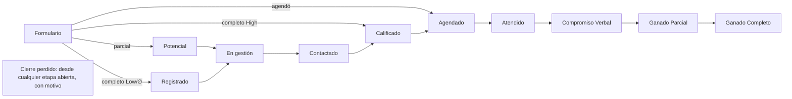

# Pipeline comercial de Retia

> Vista, no fuente (22-oct). Las fuentes son `lib/deals/etapas.ts`, `lib/ingesta/etapa-de-entrada.ts`, el estándar de
> puntaje de `docs/dapta/README.md` y los ADR 0069, 0070, 0102 y 0103. Las cifras salen de producción el 22-oct.

## 1. Recorrido

Solo `moverEtapa()` escribe la etapa. Un abono mueve a ganado. Anular no es Cierre perdido.

## 2. Score, Lead Value y Lead Quality (los calcula el formulario)

| Pregunta | Respuesta | Puntos | Efecto |
|---|---|---:|---|
| Ingreso | bajo el corte del programa | 0 | descalifica (−100 al score) |
| | los tres rangos de arriba | 10 · 20 · 30 | |
| Situación | estudiante o desempleado / 0-5 años o pensionado / 5-15 o +15 años | 0 / 10 / 20 | |
| Urgencia | "No es prioridad" | 0 | descalifica |
| | "Puede esperar" | 0 | **−1 nivel de Lead Value** |
| Inversión | "No cuento con los recursos" | 0 | descalifica |
| | "Facilidades de pago" | 0 | **−1 nivel de Lead Value** |

- **Score** = puntos (0 a 50) − 100 × descalificantes.
- **Lead Quality:** `High` sin descalificantes (ve el Calendly), `Low` con alguno.
- **Lead Value (ADR 0102, vigente desde el 22-oct en los Typeform):** el nivel por puntos (30-50 MUY ALTO, 15-29 ALTO,
  0-14 VALOR MEDIO) baja uno por tener descalificantes, uno por "facilidades de pago" y uno por "puede esperar". El piso
  es BAJO VALOR. Solo ordena el trabajo, no decide la etapa.

| Ejemplo (50 puntos) | Lead Value |
|---|---|
| capacidad + muy urgente | 🟣 MUY ALTO |
| facilidades + muy urgente (el caso de Joana) | 🔵 ALTO |
| capacidad + puede esperar | 🔵 ALTO |
| facilidades + puede esperar | 🟡 VALOR MEDIO |

## 3. Dónde nace el deal (ADR 0069)

| Envío | Nace en |
|---|---|
| agendó (cualquier calidad) | Agendado |
| parcial sin agenda | Potencial |
| completo `High` sin agenda | Calificado |
| completo `Low` o sin calidad | Registrado |

Un envío mejor sube el deal de Potencial o Registrado (ADR 0073). Nunca lo baja.

## 4. Etapas y pendientes

| Etapa | Bloque | La mueve | Deals |
|---|---|---|---:|
| Potencial · Registrado | Setteo | sistema | 238 · 870 |
| En gestión · Contactado · Calificado | Setteo | setter / sistema | 2 · 0 · 4 |
| Agendado | Llamada | la cita | 548 |
| Atendido · Compromiso Verbal | Llamada | closer | 36 · 12 |
| Ganado Parcial · Completo | Llamada | el abono | 20 · 24 |
| Cierre perdido | | closer, con motivo | 10 |

Los **pendientes** no son etapas: el deal se queda donde está.

| Pendiente | Lo pone | Hoy |
|---|---|---:|
| Re-agenda | el sistema (no-show o cancelada) o el closer (otra llamada) | 66 |
| Seguimiento | el closer, con fecha | 10 |
| Próxima Cohorte | el closer, con cohorte destino | 0 |

## 5. Decisiones del 22-oct (loom de Nicolás)

| Qué | Decisión | Dónde |
|---|---|---|
| "Joana salió MUY ALTO y pidió facilidades" | La intención baja Lead Value. Medido: facilidades vende 7 % contra 21 %; puede esperar, 8 % contra 19 %. Simulado: los niveles quedan en 23, 15, 6 y 0 % de venta. Aplicado en los tres Typeform el 22-oct; quedan Form30x y Dapta | ADR 0102 · 295 |
| Re-agendas mezcladas con citas nuevas | Columna **Re-agenda** a la izquierda de Agendado, armada con el pendiente. Sin etapa nueva | ADR 0103 · 296 |
| Scroll hasta sus columnas | Vistas **Llamada** (Re-agenda → Cierre perdido), **Setteo** (Potencial → Calificado) y **Todo**. Cada persona entra en la última que usó | ADR 0103 · 296 |
| Filtrar en el formulario para subir la asistencia | No. Se perderían ventas: 5 de 20 vinieron de "facilidades". El Lead Value nuevo ordena el esfuerzo de confirmación | ADR 0102 |

**Efectos a tener presentes:**
- La llamada calificada del Hub (MUY ALTO + ALTO) baja. Con los datos de hoy serían 102 de 144 citas en vez de 142.
- Los leads de antes del 22-oct conservan su Lead Value.
- Tactical llegó sin Lead Value del 19 al 22-oct (unos 82 envíos), porque su Typeform había perdido la lógica. Se
  restauró con el cambio.
- A los 30 días se repite la medición con los leads nuevos.
